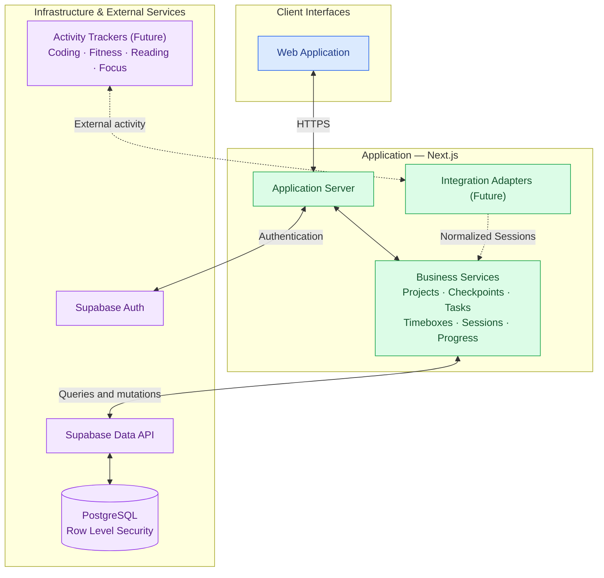

# Architecture

## Tech Stack

**Frontend:**

Next.js is the main framework of frontend.

Use Biome for linting and formatting.

Vitest for Unittests.

React Testing Library for Component Tests.

Playwright for E2E tests.

Shadcn as Component Library.

**Backend:**

Supabase is the BaaS of this project.

## Frontend Codebase Structure

@ apps/web

src/
    routes/     Tanstack router
    features/
        {feature}/
            components/     Specific Components of this feature
            api.ts          
            page.tsx        Main page component
            hooks.ts        Feature Specific Hooks
            types.ts        Feature specific Types
    components/     Shared Components
        ui/
        layout/
    lib/    Shared Libraries
        supabase/
    hooks/  Shared Hooks
    test/   Vitest Unit Tests
e2e/        Playwright E2E Tests
    {feature}.spec.ts

## Supabase Codebase Structure

@ apps/supabase

config.toml
migrations/
seed.sql
