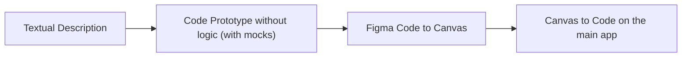

## Design Workflow

The base prototyping process follows as:

## Figma Integration

Whenever requested to implement a screen that is prototyped on Figma, or to prototype an idea, you must use the Figma skills and MCP integration.

The prototype of this project is located at: https://www.figma.com/design/e3zOECxgnjbjEyRNTBFbkB/Prototype?node-id=0-1&p=f&t=XJJOGXztgruThUn0-0

You always must prototype on the page `Prototype`

## Prototype Fidelity

Use the existing prototype as the visual source of truth. Match its layout, proportions, spacing, typography, colors, icons, navigation hierarchy, and component states closely; do not substitute a generic shadcn layout or invent a new visual treatment. Reuse its design tokens and visual patterns while keeping production components maintainable.

Compare the implementation with the prototype at matching viewport sizes, including expanded and collapsed navigation. Preserve accessibility and responsive requirements when adapting prototype behavior. Keep feature scope separate from visual fidelity: use faithful placeholders where functionality is not implemented, and omit prototype-only controls and mock business behavior.

## Design System

This project uses **shadcn** design library and design system. All the components must be based on shadcn components when possible.  

Use `shadcn-ui-kit-community-edition--Community` library as base for components on prototype.
